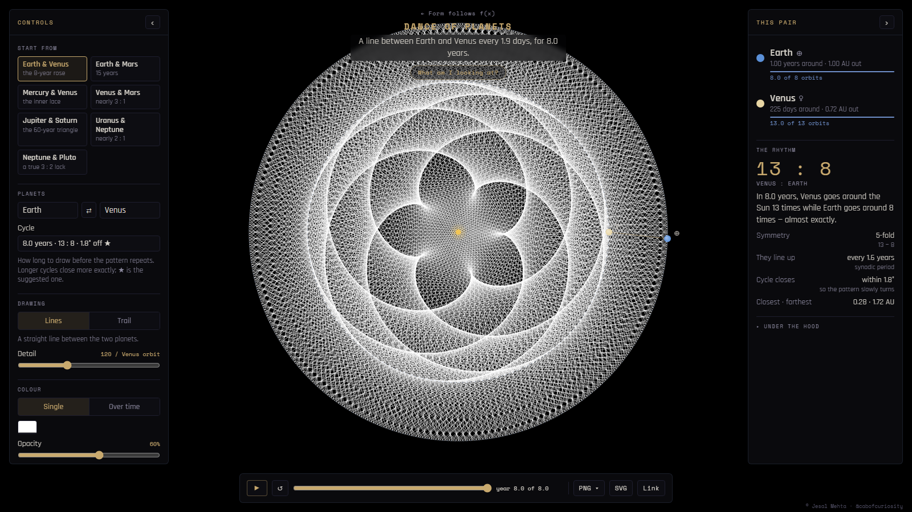

# Dance of Planets

*Two planets, one line every few days: the ratio of their orbits draws a rose, a trefoil, a lace ring.*

Dance of Planets is an interactive p5.js page. Pick two planets and it draws a line between them at regular intervals as they go around the Sun (or traces the point halfway between them). Over one shared cycle, the ratio of their orbital periods resolves into a symmetrical figure. The best-known example is the five-fold rose that Earth and Venus trace over eight years.

The page is meant both for exploring the orbital relationships and for making the resulting harmonic, spirograph-like drawings. It exports them as high-resolution PNG or as SVG.



*Dance of Planets v3.0, desktop layout: the Earth & Venus preset after one full 8-year cycle, Lines style, default detail and opacity. The "← Form follows f(x)" link and the page title come from the site the tool was first built for.*

There is no public hosted demo yet. To try it, run it locally (below).

- [Development history](HISTORY.md): from the hand-coded 2021 Dance of Venus sketches to the current page
- [Credits](CREDITS.md): authorship, AI assistance, data sources and dependencies
- [Archive](archive/README.md): selected original p5.js sketches, 2021–2024

## Running it locally

The page is five static files with no build step:

```text
index.html             page markup, help text, script order
dance_of_planets.css   styles
model.js               orbital maths (no DOM, no p5)
ui.js                  settings, controls, info panel, URL state
dance_of_planets.js    the p5 sketch: drawing, overlay, export
```

Open `index.html` in a browser, or serve the folder with any static file server, for example:

```sh
python -m http.server 8000
# then open http://localhost:8000/
```

It needs a network connection: p5.js 1.9.0 comes from cdnjs, and the Space Mono and Rajdhani fonts come from Google Fonts. The scripts are plain (not ES modules), so they must load in the order in `index.html`: p5 → `model.js` → `ui.js` → `dance_of_planets.js`.

## Using it

### Planets, presets and cycles

- **Start from** offers seven presets: Earth & Venus (the 8-year rose), Earth & Mars, Mercury & Venus, Venus & Mars, Jupiter & Saturn (the 60-year triangle), Uranus & Neptune, and Neptune & Pluto.
- **Planets** picks any two of the nine bodies, Mercury to Pluto. ⇄ swaps them. Picking the planet already chosen on the other side swaps the pair.
- **Cycle** sets how long to draw before the pattern repeats. Each option reads like `8.0 years · 13 : 8 · 1.8° off`: the cycle length, how many orbits each planet makes, and how far the slower planet falls short of returning to its start. Longer cycles close more exactly. ★ marks the suggested one.

The cycle options are the continued-fraction convergents of the two planets' speed ratio, which are its best rational approximations. The suggested cycle is the first one that closes to within 10° and fits the line budget; two presets pin a specific cycle (Jupiter & Saturn at 5 : 2, Neptune & Pluto at 3 : 2).

**A cycle closing is a property of the drawing, not a physical claim.** A cycle "closes" because the rounded periods in the data table make a near-whole-number ratio. Some pairs do have real orbital resonances (Neptune and Pluto are in a 3 : 2 mean-motion resonance), but the tool doesn't simulate gravity or resonance. It only draws two circles at fixed rates.

### Drawing: Lines or Trail, and Detail

- **Lines** draws a straight line between the two planets at every step.
- **Trail** joins the successive midpoints of the two planets, tracing the path of the point halfway between them.
- **Detail** is the number of lines per orbit of the faster planet (24–2880 on the slider; default 120). It changes the picture: more lines make a denser figure. The readout shows the equivalent interval, for example "a line every 1.9 days" in the caption. The total number of lines in one cycle is capped at 150,000; when a long cycle hits that cap, Detail is reduced and the readout says "(max here)".

### Colour

- **Single** (default): one colour for every line.
- **Over time**: a gradient from a start colour to an end colour across the cycle.
- **Opacity** (5–100 %, default 60 %): overlapping translucent lines build up tone.
- **Line weight** (0.25–4 px).

### Motion and animation

- **Speed** is how fast the drawing animates, in **orbits of the faster planet per second** (0.02–20; default 0.5). The readout translates this into years (or days) of planet time per second. Speed never changes the finished picture, and changing Detail doesn't change how long a cycle takes to draw. Animation timing assumes about 60 frames per second; a machine that drops frames draws more slowly rather than skipping.
- **Draw once** stops at the end of the cycle.
- **Keep drawing** lets time run on past the end of the cycle, so a cycle that doesn't close exactly slowly rotates (Earth–Venus turns by about 1.8° per cycle). **Old lines fade** sets how quickly earlier lines dim.
- The **transport bar** has play/pause, start again, and a scrubber labelled in years.

### Show

- **Planets & Sun**: small drawn discs with astronomical glyphs, and the current line. They never leave a trail.
- **Orbits**: dashed orbit circles.
- **Zoom** (25–800 %, or scroll on the canvas) and **fit**.

### Changing settings mid-drawing

Settings apply immediately; there's no Reset button. The drawing is a function of its settings and its progress through the cycle, so a change is handled in one of three ways:

| Kind of change | Settings | What happens |
|---|---|---|
| Doesn't touch the drawing | speed, Planets & Sun, Orbits, pause | applies instantly |
| Changes how it looks | zoom, colour, opacity, line weight, detail, style, Classic | redrawn from the start up to the same point in the cycle |
| A new picture | planet pair, preset, cycle | starts again from zero |

In *Keep drawing* mode, a redraw rebuilds the fading tail with a calculated alpha ramp rather than replaying every frame. Just after a change, the image is therefore slightly cleaner than one that has been running for a long time.

### Classic v2 speeds (Advanced)

Versions 2.0–2.2 of the page used each planet's orbital **period** directly as its angular speed, so outer planets moved *faster* than inner ones, the reverse of real orbits. Version 3.0 corrects this (angle ∝ time ÷ period). The **Classic v2 speeds** toggle under *Advanced* restores the old behaviour, so earlier images can be reproduced and the two can be compared.

Under Classic:

- the symmetry count is the same (it depends only on the ratio), but the shapes are different;
- the drawing turns clockwise on screen (the corrected orbits run counter-clockwise, as seen from above the Sun's north pole);
- the time parameter is no longer in years, so "days per line" isn't defined;
- the facts in *This pair* still describe the real orbits, and a badge says so.

Classic is not a physical model. It is kept for comparison and reproducibility. See [HISTORY.md](HISTORY.md) for where the reversed speeds came from.

### The information panel

*This pair* shows each planet's period, distance and live orbit count, then **The rhythm**: the orbit ratio, a plain-language sentence ("In 8.0 years, Venus goes around the Sun 13 times while Earth goes around 8 times — almost exactly"), the symmetry (13 − 8 = 5-fold), the synodic period (how often the two line up), how closely the cycle closes, and the closest and farthest distances. *Under the hood* lists the raw numbers: lines drawn, step size, lines per frame, fade alpha, cycle ratio and the speed rule in use.

### Shareable links

Every setting is written into the page's address as you change it, using short keys and only non-default values (for example `?a=jupiter&b=saturn&cy=5:2`). **Link** copies that address. Opening it restores the pair, cycle, style, detail, colour, opacity, weight, speed, loop mode, fade, zoom, overlay toggles and Classic. It does not store the playback position: a shared link starts the drawing from the beginning. Collapsed panels are remembered per browser, not in the link.

### Export

- **PNG ▾**: *Screen size*, *2048 px* or *4096 px · print*.
- **SVG**: a 1000 × 1000 vector file.

Both are re-rendered off-screen from the drawing's data rather than captured from the screen. Exports are:

- **square**, centred on the Sun, at the same zoom relative to the fitted view, whatever the window's shape;
- **on black**, with **only the drawing**: the planets, Sun, orbits and the current line are not included;
- in *Keep drawing* mode, of the current reconstructed fading tail.

Line weight scales with the export size, so a 4096 px PNG looks like the screen view, only sharper; lower *Line weight* before exporting for finer print lines. In the SVG, each line segment is its own `<path>`, so translucent lines overlap as on screen. Above 60,000 lines the page warns before writing a large SVG (roughly 110 bytes per line). File names record the time, the pair, the cycle and the style.

### Keys

<kbd>Space</kbd> play / pause · <kbd>R</kbd> start again · <kbd>H</kbd> hide the interface for clean captures · <kbd>Esc</kbd> close dialogs · scroll to zoom

On screens 900 px wide or narrower, the two panels become bottom sheets opened from the transport bar.

## The astronomy, simplified

- Orbits are **circles in one plane**, centred on the Sun, and **all planets start in line** at time zero. Real orbits are elliptical and inclined, so this is a geometric drawing, not an ephemeris: it doesn't show where the planets are on any real date.
- Periods and distances are a short table of rounded values (for example Venus 0.615 years and 0.72 AU, Jupiter 11.9 years and 5.2 AU), taken from the HyperPhysics and JPL references credited in [CREDITS.md](CREDITS.md). Pluto is included. Changing these values would subtly change every drawing, so the table has been left as it was in the earlier versions.
- The facts are worked out from these values: synodic period = 1 / |1/P₁ − 1/P₂|; closest and farthest distances = the difference and sum of the two orbit radii.
- The symmetry of a figure, |p − q| for a p : q cycle, follows from the ratio alone.

## How it works

Three plain scripts share one global namespace, `window.DOP`:

- **`model.js` → `DOP.model`**: the planet table, presets and line budget. `makePair()` computes everything about a pair that doesn't depend on the look: angular rates (correct: 360° ÷ period per year; Classic: the period itself), the convergent cycle list and the chosen cycle, the step grid, positions at each step, orbit counts, synodic period and distances. No DOM, no p5.
- **`ui.js` → `DOP.settings`, `DOP.ui`**: owns the settings, wires every control, fills the information panel and caption, and keeps the address bar in sync. Every change is dispatched by tier: nothing, redraw, re-grid (Detail and Classic change the step grid but keep the same fraction of the cycle), loop mode, or new picture.
- **`dance_of_planets.js` → `DOP.sketch`**: the p5 instance. The drawing accumulates in an off-screen `p5.Graphics` layer. A single routine, `drawRange()`, draws a range of steps; it is used for live frames, full redraws, PNG export and (as a list of segments) SVG export. Opaque single-colour runs are batched into one path; translucent or gradient lines are stroked one by one, so overlaps build up tone. The overlay (Sun, orbits, planets, current line) is drawn on top of the layer each frame and never enters it.

## Known limitations

- **Real devices:** layout and controls have been exercised in headless Chromium at desktop and phone sizes, not yet on physical phones (touch scrubbing, bottom sheets) or high-DPI desktops (cost of the full-window layer).
- **Timing** assumes about 60 fps.
- **Keep drawing** after a settings change is an approximation of a long-running fade (see above). On 8-bit canvases, the very low per-frame fade never quite reaches black, so faint grey ghosts remain in a long-running drawing. This is part of the existing look.
- **Simplified astronomy:** circular, coplanar orbits and rounded data.
- **Long cycles** (for example Mercury–Pluto, roughly 1029 : 1) hit the 150,000-line budget, which lowers the available Detail. SVGs of dense drawings are large.
- **Network:** p5.js and the fonts come from CDNs, so the page doesn't work offline as shipped.
- **Leftovers from the original site:** the "← Form follows f(x)" link points to the parent folder (`../`), and the page title ends in "— Form follows f(x)". A few source comments refer to a design document (`DANCE-OF-PLANETS.md`) that isn't part of this repository.

## Licence and terms

- **Application code** (`index.html`, `dance_of_planets.css`, `dance_of_planets.js`, `model.js`, `ui.js`): © Jesal Mehta, licensed under the **GNU General Public License v3.0 or later** ([LICENSE](LICENSE)). You may use, study, change and share it; if you distribute a modified version, including by hosting it on a website, you must make its source available under the same licence. Third-party components keep their own licences (see [CREDITS.md](CREDITS.md)).
- **Historical sketches** in [`archive/`](archive/README.md) stay under their original notice: copyright Jesal Mehta; the output is free to use for non-commercial purposes; contact the author for a different licence. The code licence doesn't cover them.
- **Screenshots and documentation:** © Jesal Mehta, all rights reserved.
- **Drawings you make with the tool** belong to you, for **non-commercial use only**. When you share them, credit Jesal Mehta or tag @cabofcuriosity.

See [CREDITS.md](CREDITS.md) for third-party components and their licences.
